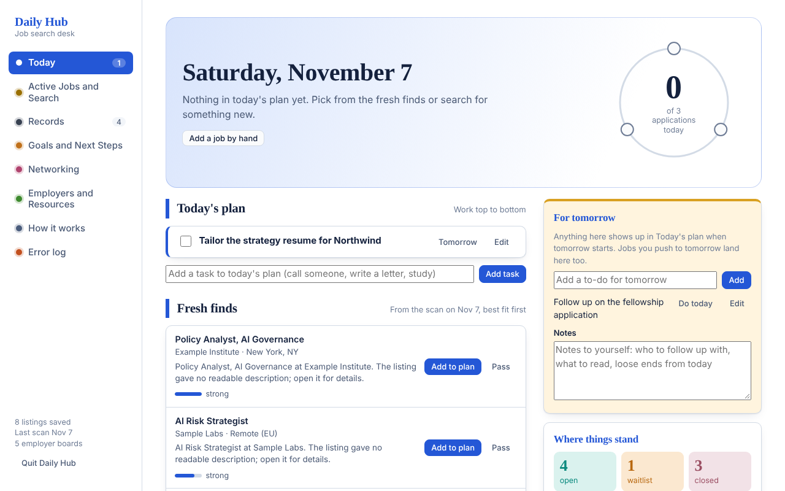

# Career Search Hub

A personalized, local-first web app for running a job search day to day: one place for today's plan, job search across several sources, application records, goals, networking and a library of employers and job boards. It runs only on your own computer, uses only the Python standard library, and keeps all data in one JSON file.

It was built and reshaped over about two weeks by one person talking to an AI assistant (Claude). The `docs/` folder records how: [how the page was personalized, request by request](docs/PERSONALIZATION.md) and [an AI-involvement statement](docs/AI_INVOLVEMENT.md).



## What it does

| Tab | Purpose |
|---|---|
| **Today** | A plan for the day (queued jobs plus your own tasks), fresh finds from the last search, a "For tomorrow" list, a daily-scan reminder with snooze, upcoming deadlines |
| **Active Jobs and Search** | Filter every saved listing by place, kind of work, fit score and source. **Refresh search** goes out and looks: job boards (LinkedIn and Indeed via web search plus other boards), local sites for the chosen places, large employers (ATS boards and career pages). Small employers are checked automatically about once a week |
| **Records** | Applications as a board or table; each can carry several tracks; the main track suggests a resume |
| **Goals and Next Steps** | Tomorrow's list, small moves, bridging goals, people to contact, a study plan |
| **Networking** | Small firms and named contacts, with follow-up nudges |
| **Employers and Resources** | Every page you watch, grouped as Job Boards, Local (a sub-tab per place), Large Employers, Small Employers and your own pages. Pages are marked *Checked today* automatically when a search reaches them |
| **How it works** | An in-app guide, the personalization record, settings |
| **Error log** | Anything that breaks, with Open / Fixed / Ignored status so an assistant (or you) can triage it |

Screenshots: [search](docs/screenshots/search.png), [records](docs/screenshots/records.png), [goals](docs/screenshots/goals.png), [employers](docs/screenshots/employers.png).

## Run it

```bash
git clone https://github.com/Marrs-jin/career-search-hub.git
cd career-search-hub
python3 hub.py          # opens http://127.0.0.1:8765/ in your browser
```

Python 3.9 or newer. No packages to install. Data is created in `data/` on first start (it is git-ignored). Optional: `bash install_shortcut.sh` adds a desktop launcher on Linux.

## Design choices

- **Local only.** The server binds to `127.0.0.1`. Nothing is sent anywhere except the searches you trigger.
- **One data file.** `data/hub.json` holds everything; timestamped backups are kept (at most one a minute, the latest 30).
- **Each function lives in one place.** Search lives under Active Jobs and Search; sources live under Employers and Resources. Where a view needs another's data it links or shows a copy of the same record.
- **Safe rendering.** The front end builds the DOM with `textContent` and a small `h()` helper, never `innerHTML` with data.
- **Fails visibly.** Errors land in the Error log with the area and message. Search layers report per-source results instead of silently returning nothing.
- **Personalization is data.** Tracks, resume suggestions and sections are plain lists you can edit (`CLUSTERS` in `static/app.js`, `TRACKS` in `hub.py`).

## Search model

1. **Job boards:** LinkedIn and Indeed through `site:` web searches, plus other board pages you list.
2. **Local:** sites you list for a place, searched when that place is in the *Where* box.
3. **Large employers:** ATS boards (Greenhouse, Lever, Ashby, SmartRecruiters, Workable, Workday) via `scanner/ats_scan.py`, plus career pages, with a web fallback restricted to the employer's own site.
4. **Small employers:** the same pages as large ones, but run weekly in the background (`weekly_loop`) or on demand.

Web search tries Google Programmable Search (if keys are set), then DuckDuckGo, then Bing.

## Configuration

Settings are in the app (**How it works > Settings**) or `data/hub.json`. Optional environment variables: `GOOGLE_API_KEY`, `GOOGLE_CSE_ID`, `ANTHROPIC_API_KEY` (short listing summaries), `HUB_SCANNER_DIR`, `PAY_FLOOR`, `HOME_CITY_RX` (scanner).

## Known limitations

- Web search from a script is fragile: search engines rate-limit or serve robot checks. Results vary by network; failures show up in the Error log.
- Some career pages need a browser to show their list; those are reported as "none found".
- The scanner's scoring weights (`scanner/ats_scan.py`) and the six example clusters reflect one person's targets. Replace them with yours.
- The scanner still names its home-city flag `chicago` internally; the pattern is set with `HOME_CITY_RX`.
- No automated test suite. Changes were checked with browser smoke tests (see the AI-involvement statement).
- Single user, no login: do not expose it beyond localhost.

## License

MIT. See [LICENSE](LICENSE).
